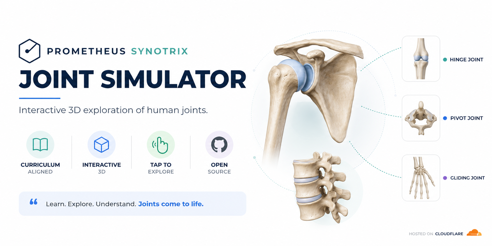
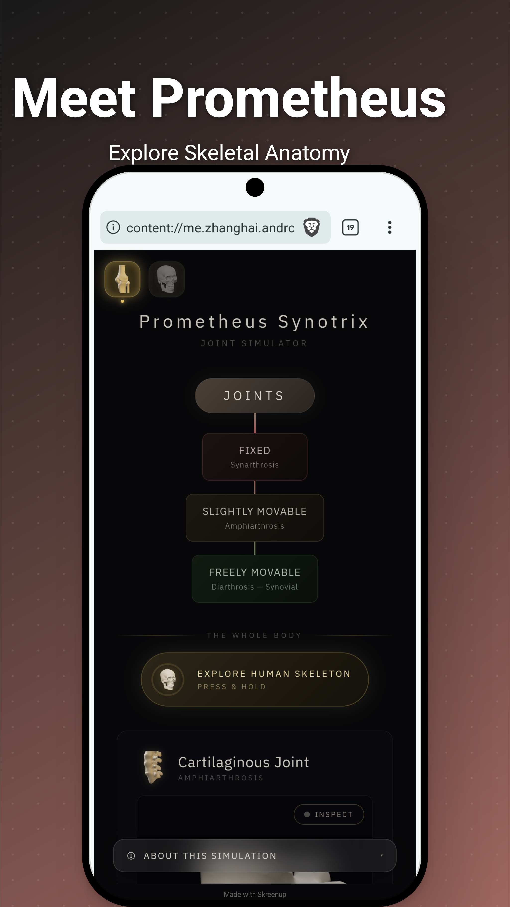
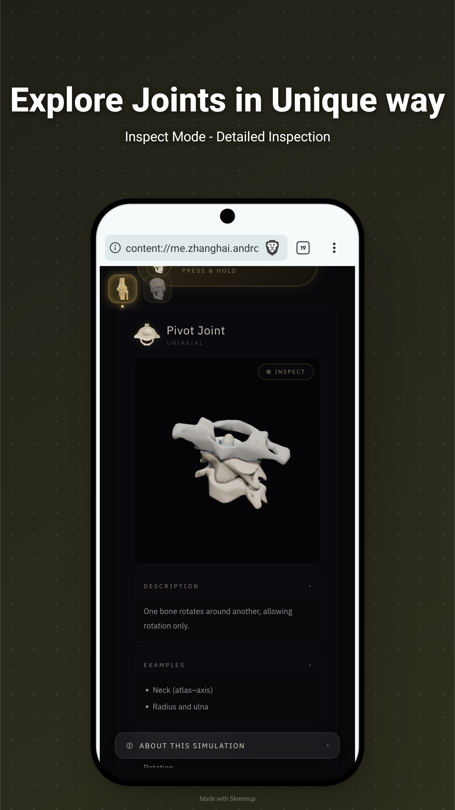
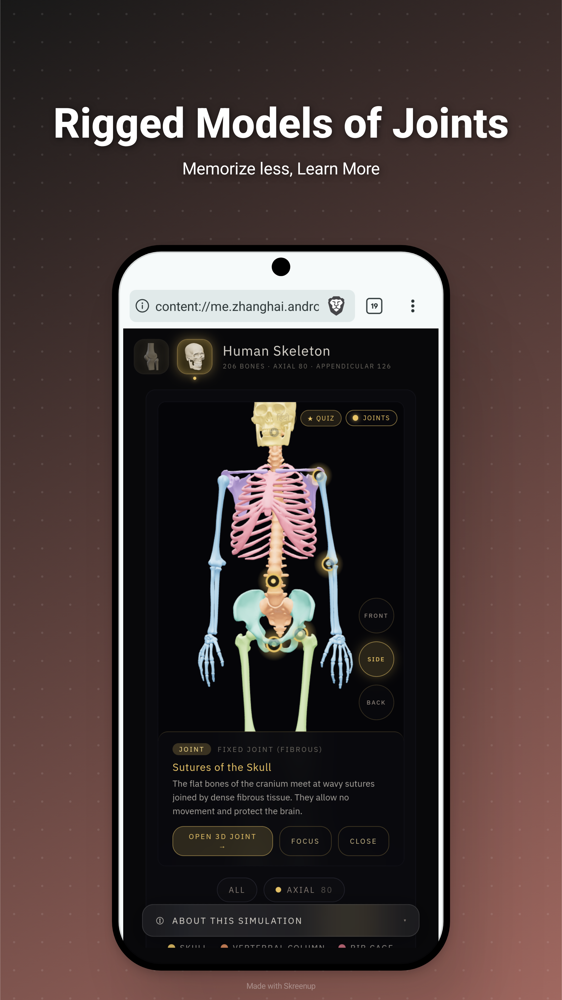

  

<h1 align="center">🦾 Prometheus Synotrix</h1><h3 align="center"><em>Interactive Human Joint Simulator</em></h3>Explore human joint anatomy, classification, and movement through interactive, rigged 3D bone models.

🦿 Human Anatomy · 🔄 Joint Movement · 🩻 Skeletal System

  <a href="https://prometheus-synotrix.stark-kodex.workers.dev"><strong>Explore the Joints →</strong></a>

---

>
<em> Project Dedicated to Sriman Narayana</em>

---

✨ **Features**

- 🦴 Anatomical Models: Explore skull, vertebrae, discs, and limb bones.
- 🦿 Rigged Joints: Visualize movement around joint centres.
- 🔍 Inspect Mode: Identify bones, cartilage, ligaments, and discs.
- 🧩 Joint Structures:  Explore sutures, gomphosis, and synovial joints.
- 📚 NCERT-Aligned: Supports Class IX & XI-level skeletal system.
- 📱 Responsive Design: Optimized for Mobile, Smart panel
- 🩻 Skeletal System: Integrated Skeletal System.

---

🖼️ **Screenshots**

<table>
  <tr>
    <td align="center" width="50%">
      
       <strong>Introduction</strong>
    </td>
    <td align="center" width="50%">
      
       <strong>Joint Anatomy</strong>
    </td>
  </tr>
  <tr>
    <td align="center" width="50%">
      
       <strong>Joint types</strong>
    </td>
    <td align="center" width="50%">
      
       <strong>Skeletal Anatomy</strong>
    </td>
  </tr>
</table>---

🦿 **Joint Classification & Skeletal System**

- Fibrous: Skull sutures, gomphosis
- Cartilaginous: Intervertebral joints
- Synovial: Shoulder, hip, atlas–axis, elbow
- Skeletal System: Types Axial,Appendicular
---

⚙️ **Technology**

HTML · CSS · JavaScript · Three.js
Repository: GitHub & Codeberg
Hosting: Cloudflare Pages

---

🙏 **Credits**

<table>
  <tr>
    <td><strong>Anatomy:</strong> <a href="https://dbarchive.biosciencedbc.jp/en/bodyparts3d/">BodyParts3D</a> · <a href="https://creativecommons.org/licenses/by/4.0/">CC BY 4.0</a> · <a href="https://fab.com/s/0ecc86fb0a8d">Fab Model</a></td>
    <td><strong>Libraries:</strong> <a href="https://threejs.org">Three.js</a> · <a href="https://github.com/zeux/meshoptimizer">meshoptimizer (MIT)</a></td>
    <td><strong>Development:</strong> Draven Ashcroft · Claude · OpenAI · Perplexity</td>
  </tr>
</table>

---

⚠️ **Educational Disclaimer**

Models are simplified for educational purposes and are not precise clinical references.

---

📜 **License**

Source code is licensed under the "GNU GPL-3.0 License" (LICENSE). Third-party assets remain subject to their respective licenses.
