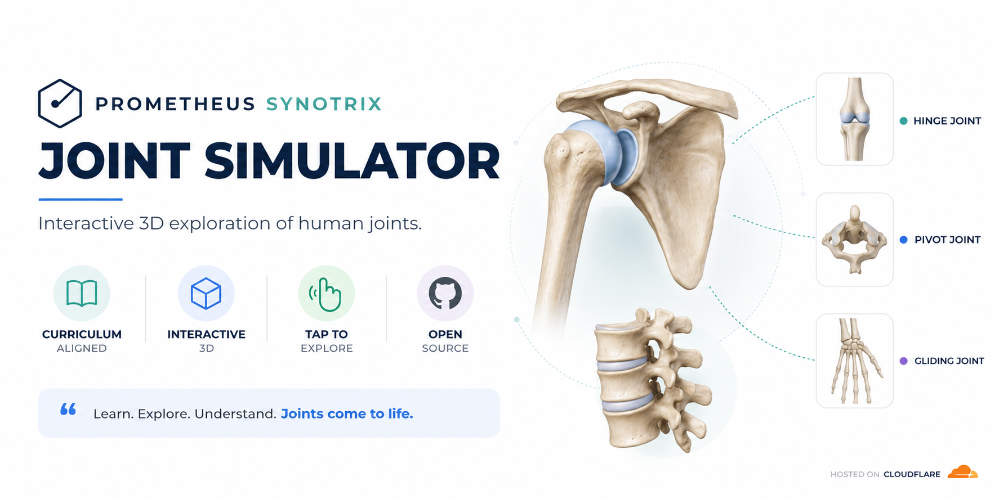
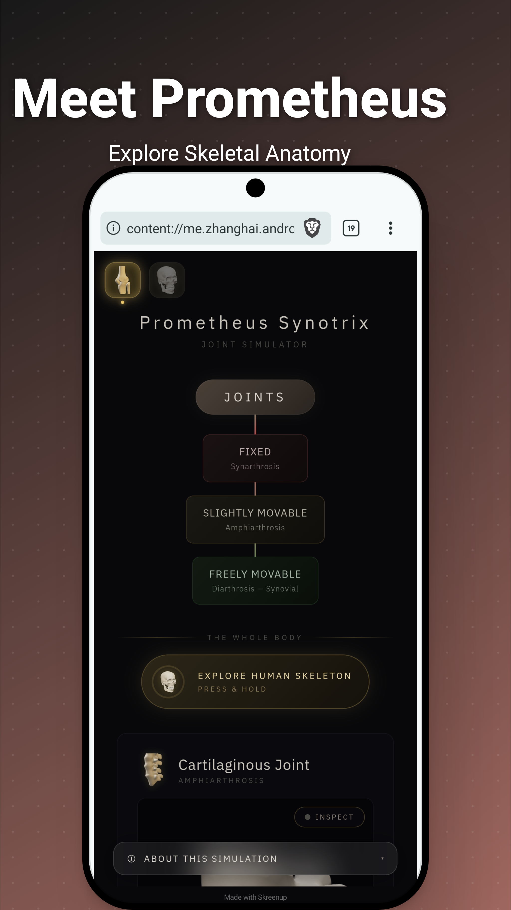
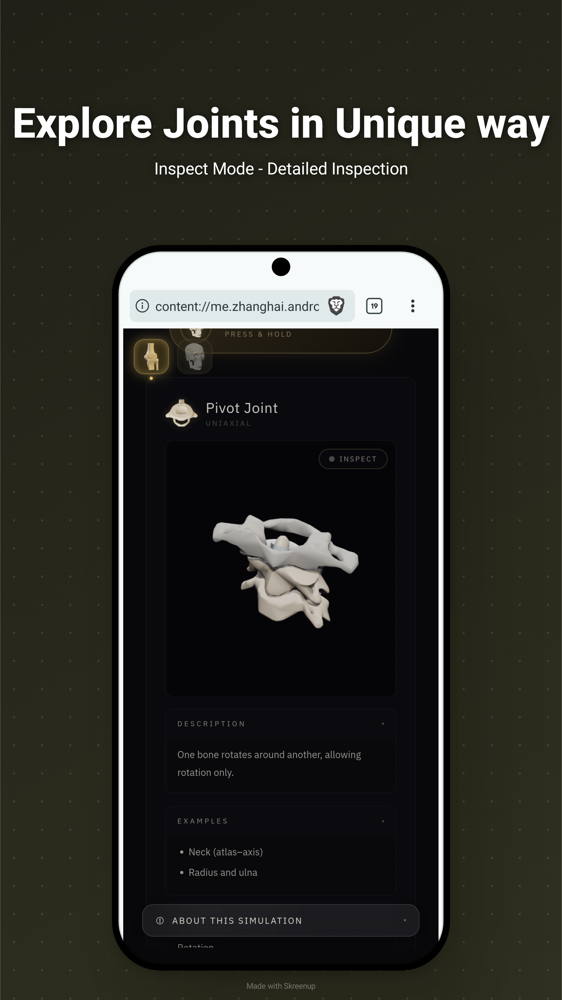
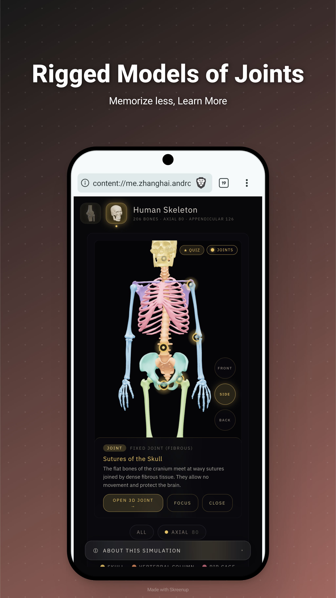

  

<h1 align="center">🦾 Prometheus Synotrix</h1>

<em>Interactive Human Joint Simulator</em>

🦿 Human Anatomy · 🔄 Joint Movement · 🩻 Skeletal System

<a href="https://prometheus-synotrix.stark-kodex.workers.dev"><strong>Explore the Skeletal System →</strong></a>

  <a href="#-two-tabs">Tabs</a> ·
  <a href="#%EF%B8%8F-screenshots">Screenshots</a> ·
  <a href="#-joint-classification">Joints</a> ·
  <a href="#-human-skeleton">Skeleton</a> ·
  <a href="#-concepts-covered">Concepts</a> ·
  <a href="#-controls">Controls</a> ·
  <a href="#%EF%B8%8F-educational-disclaimer">Disclaimer</a> ·
  <a href="#-technology">Technology</a> ·
  <a href="#-credits">Credits</a>

---

<em>Project dedicated to Lord Vishnu</em>

---

## 📖 About

An interactive 3D simulator for teaching how the human skeleton is built and how its joints move. Real bone models let students see:

- **how joints are classified** by the movement they allow
- **what is inside a joint**: bones, cartilage, ligaments, discs and synovial fluid
- **where each bone sits** in the 206-bone skeleton, and which division it belongs to

Aligned with NCERT for Class IX and XI. Built for classroom smart panels; it works on phones too.

---

## 🖼️ Screenshots

<table>
  <tr>
    <td align="center" width="50%">
      
       <strong>Introduction</strong>
    </td>
    <td align="center" width="50%">
      
       <strong>Joint anatomy</strong>
    </td>
  </tr>
  <tr>
    <td align="center" width="50%">
      
       <strong>Joint types</strong>
    </td>
    <td align="center" width="50%">
      
       <strong>Skeletal anatomy</strong>
    </td>
  </tr>
</table>

---

## ✦ Two Tabs

Switch tabs with the two icons at the top: the knee icon for joints, the skull icon for the skeleton.

| Tab | What it shows |
|:--|:--|
| 🦵 **Types of Joints** | A joint classification chart that opens a 3D scene, description, examples and allowed movement for each joint type |
| 💀 **Human Skeleton** | The full 3D skeleton with bone identification, axial and appendicular filters, joint markers, Hindi names and a quiz |

### 🦵 Types of Joints

- Tap **INITIATE**, then choose a branch of the chart:

| Branch | Type | Further choices |
|:--|:--|:--|
| 🔴 **Fixed** | Synarthrosis | — |
| 🟡 **Slightly movable** | Amphiarthrosis | — |
| 🟢 **Freely movable** | Diarthrosis (synovial) | Ball & Socket · Pivot · Hinge |

- Each type opens a **3D diagram** with three cards: **Description**, **Examples** and **Movement Allowed**.
- Turn on **Inspect**, then tap a structure in the 3D scene to see its name and a short description, such as the nucleus pulposus of a disc, the glenoid labrum, the acetabulum or the transverse ligament.

### 💀 Human Skeleton

- **Tap any bone** to identify it. A card shows its name and description, with **Focus** to zoom in on it.
- Choose the **Front, Side or Back** camera view.
- Filter the skeleton by division: **All · Axial (80) · Appendicular (126) · Regions**. Regions colours the skeleton by body region and shows a legend.
- Gold **joint markers** sit on real joints. Tap one for its description, then **Open 3D joint →** to jump straight to that joint in the Types of Joints tab. Use the **Joints** toggle to show or hide them.
- **हिंदी** switches bone names between English and Hindi.
- **★ Quiz** is a 10-question find-the-bone game with a score.

---

## 🦿 Joint Classification

| Type | Examples in the simulator |
|:--|:--|
| **Fixed (fibrous)** | Skull sutures (coronal, sagittal, lambdoid, squamous) · Gomphosis (tooth in socket) |
| **Slightly movable (cartilaginous)** | Between vertebrae · Pubic symphysis · First rib–sternum |
| **Freely movable (synovial)** | Shoulder · Hip · Knee · Elbow · Wrist · Ankle |
| ↳ Ball & socket | Shoulder · Hip |
| ↳ Pivot | Atlas–axis |
| ↳ Hinge | Elbow · Knee |

**Joint markers on the skeleton:** skull sutures, atlas–axis, shoulder, elbow, intervertebral joint, pubic symphysis, hip and knee. Limb joints are marked on the subject's left side; the subject faces you in Front view, so their left is on your right.

---

## 🩻 Skeleton Divisions

| Division | Bones |
|:--|:--|
| **Axial skeleton** | **80**: skull 29 (cranial 8, facial 14, hyoid 1, ear ossicles 6) · vertebral column 26 · sternum 1 · ribs 24 |
| **Appendicular skeleton** | **126**: upper limbs 60 · lower limbs 60 · pectoral girdle 4 · pelvic girdle 2 |

---

## 🌱 Concepts Covered

| Area | Concepts |
|:--|:--|
| Classification | Fixed, slightly movable and freely movable joints · Synarthrosis, amphiarthrosis, diarthrosis |
| Synovial joints | Ball-and-socket, pivot and hinge joints · Synovial cavity and fluid · Articular cartilage · Ligaments |
| Anatomy | Axial and appendicular skeleton · Regions of the skeleton · Vertebral column · Bone identification |
| Movement | Range of movement for each joint type · Flexion and extension |

---

## 🧭 Controls

| Where | Action | What it does |
|:--|:--|:--|
| Joints tab | Left-click drag · Right-click drag · Scroll | Rotate · Pan · Zoom the 3D joint |
| Joints tab | **Inspect** toggle, then tap | Name and describe a structure |
| Skeleton tab | Drag · Pinch or scroll · Right-drag | Rotate · Zoom · Pan |
| Skeleton tab | Tap a bone | Identify it |
| Skeleton tab | Front · Side · Back | Change the camera view |
| Skeleton tab | All · Axial · Appendicular · Regions | Filter the skeleton |
| Skeleton tab | **Joints** · **हिंदी** · **★ Quiz** | Markers · language · quiz |

---

## ⚠️ Educational Disclaimer

Models are simplified for educational purposes and are not precise clinical references. In the skeleton model:

- the vertebrae are fused into one piece per region
- each toe's metatarsal and phalanges form one piece, so they are labelled as groups
- the hyoid and the ear ossicles are not shown
- teeth are shown but are not bones

Hindi names follow NCERT Hindi-medium terms.

---

## 💻 Technology

HTML · CSS · JavaScript · Three.js

Repository: GitHub & Codeberg · Hosting: Cloudflare Pages

---

## 🙏 Credits

| | Credit |
|:--|:--|
| **Anatomy** | [BodyParts3D](https://dbarchive.biosciencedbc.jp/en/bodyparts3d/) · © The Database Center for Life Science · [CC BY 4.0](https://creativecommons.org/licenses/by/4.0/) · [Fab model](https://fab.com/s/0ecc86fb0a8d) |
| **Libraries** | [Three.js](https://threejs.org) · [meshoptimizer](https://github.com/zeux/meshoptimizer) (MIT) |
| **Development** | Draven Ashcroft · Claude · OpenAI · Perplexity |

The bone models were simplified and repositioned for this simulator. Additional bones are adapted from `Skeleton.obj`.

---

## 📜 License

Source code: **GNU GPL-3.0** (see [LICENSE](LICENSE)). Third-party assets remain subject to their respective licences.

---

  <b>Repository</b>: GitHub · Codeberg &nbsp;&nbsp;|&nbsp;&nbsp; <b>Hosting</b>: Cloudflare Pages

