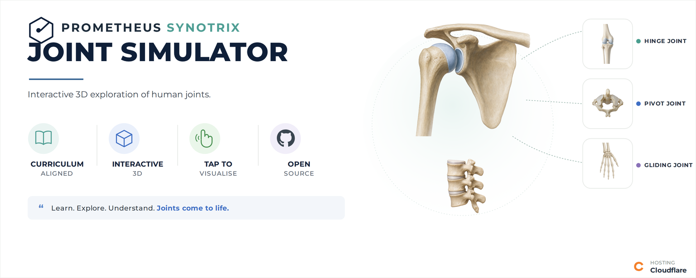

  

<h1 align="center">🦾 Prometheus Synotrix</h1><h3 align="center"><em>Interactive Human Joint Simulator</em></h3>Explore human joint anatomy, classification, and movement through interactive, rigged 3D bone models.

🦿 Human Anatomy · 🔄 Joint Movement · 🩻 Skeletal System

  <a href="https://prometheus-synotrix.stark-kodex.workers.dev"><strong>Explore the Joints →</strong></a>

---

✨ Features

- 🦴 Anatomical Models — Explore skull, vertebrae, discs, and limb bones.
- 🦿 Rigged Joints — Visualize movement around joint centres.
- 🔍 Inspect Mode — Identify bones, cartilage, ligaments, and discs.
- 🧩 Joint Structures — Explore sutures, gomphosis, and synovial joints.
- 📚 NCERT-Aligned — Supports school-level skeletal system studies.
- 📱 Responsive Design — Desktop and mobile support.

---

🖼️ Screenshots

<table>
  <tr>
    <td align="center" width="50%">
      
       <strong>Introduction</strong>
    </td>
    <td align="center" width="50%">
      
       <strong>Joint Anatomy</strong>
    </td>
  </tr>
  <tr>
    <td align="center" width="50%">
      
       <strong>Joint Classification</strong>
    </td>
    <td align="center" width="50%">
      
       <strong>Skeletal Anatomy</strong>
    </td>
  </tr>
</table>---

🦿 Joint Classification

- Fibrous: Skull sutures, gomphosis
- Cartilaginous: Intervertebral joints
- Synovial: Shoulder, hip, atlas–axis, elbow

---

⚙️ Technology

HTML · CSS · JavaScript · Three.js

Repository: GitHub & Codeberg
Hosting: Cloudflare Pages

---

🙏 Credits

- Anatomical Models: "BodyParts3D" (https://dbarchive.biosciencedbc.jp/en/bodyparts3d/) · "CC BY 4.0" (https://creativecommons.org/licenses/by/4.0/) (modified)
- Additional 3D Asset: "Fab Model" (https://fab.com/s/0ecc86fb0a8d)
- Libraries: "Three.js" (https://threejs.org) · "meshoptimizer" (https://github.com/zeux/meshoptimizer) (MIT)
- Development: Concept, design, and validation by Draven Ashcroft, Biology Lecturer, with AI assistance from Claude, OpenAI, and Perplexity.

---

⚠️ Educational Disclaimer

Models are simplified for educational purposes and are not precise clinical references.

---

📜 License

Source code is licensed under the "GNU GPL-3.0 License" (LICENSE). Third-party assets remain subject to their respective licenses.
