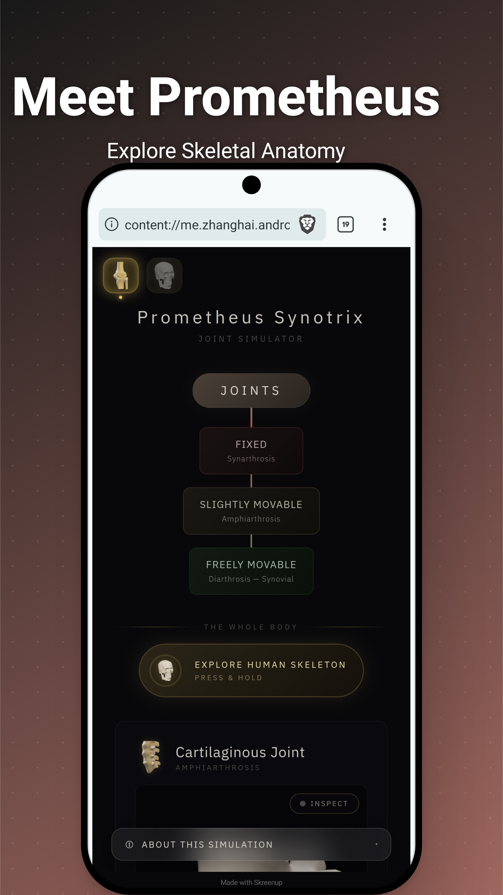
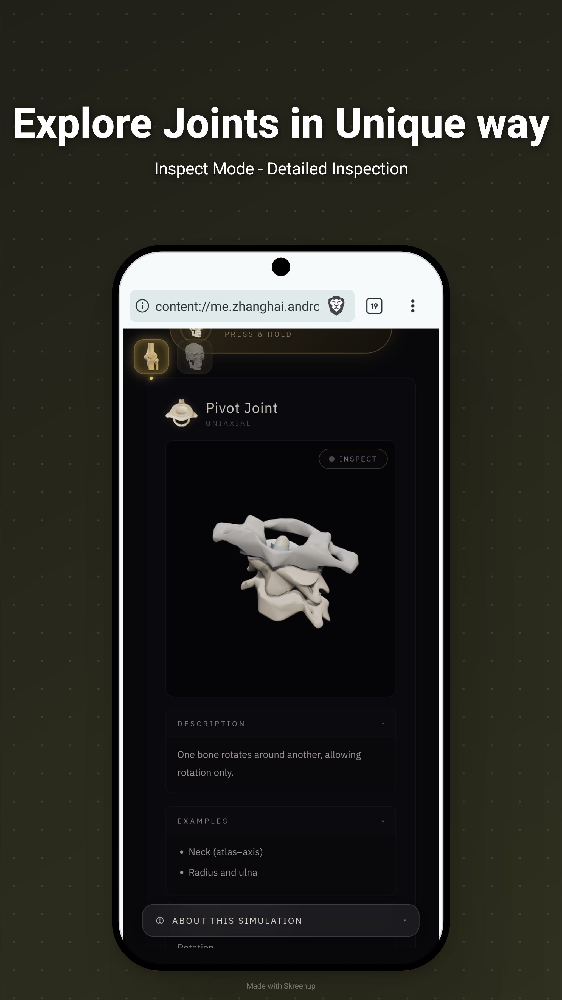

  

<h1 align="center">Prometheus Synotrix</h1>

<em>Interactive Human Joint Simulator</em>

<a href="https://prometheus-synotrix.stark-kodex.workers.dev"><strong>Explore the Skeletal System</strong></a>

  <a href="#about">About</a> ·
  <a href="#screenshots">Screenshots</a> ·
  <a href="#two-tabs">Tabs</a> ·
  <a href="#joint-classification">Joints</a> ·
  <a href="#skeleton-divisions">Skeleton</a> ·
  <a href="#concepts-covered">Concepts</a> ·
  <a href="#controls">Controls</a> ·
  <a href="#educational-disclaimer">Disclaimer</a> ·
  <a href="#technology">Technology</a> ·
  <a href="#credits">Credits</a>

<em>Project dedicated to Lord Vishnu</em>

---

## About

**Turn a skeleton in your hands. See how every joint moves.**

An interactive 3D simulator for teaching how the human skeleton is built and how its joints move. Real bone models show how joints are classified, what is inside a joint, and where each of the 206 bones sits. Aligned with NCERT Class IX and XI. Built for classroom smart panels and phones.

---

## Screenshots

<table width="100%">
  <tr>
    <td width="50%" align="center">
      
       <b>Introduction</b>
    </td>
    <td width="50%" align="center">
      
       <b>Joint anatomy</b>
    </td>
  </tr>
  <tr>
    <td width="50%" align="center">
      
       <b>Joint types</b>
    </td>
    <td width="50%" align="center">
      
       <b>Skeletal anatomy</b>
    </td>
  </tr>
</table>

---

## Two Tabs

| Types of Joints | Human Skeleton |
|:--|:--|
| A classification chart: **Fixed**, **Slightly movable** or **Freely movable** (Ball & Socket · Pivot · Hinge). Each opens a 3D joint with its description, examples and movement. **Inspect** names any structure you tap. | The full 3D skeleton. Tap a bone to identify it, filter **Axial · Appendicular · Regions**, open gold joint markers, switch to **हिंदी**, or take the 10-question **Quiz**. |

---

## Joint Classification

| Type | Examples in the simulator |
|:--|:--|
| **Fixed** (fibrous · synarthrosis) | Skull sutures · Tooth in socket |
| **Slightly movable** (cartilaginous · amphiarthrosis) | Between vertebrae · Pubic symphysis · First rib–sternum |
| **Ball & socket** (synovial) | Shoulder · Hip |
| **Pivot** (synovial) | Atlas–axis |
| **Hinge** (synovial) | Elbow · Knee |

Joint markers on the skeleton link straight to the matching 3D joint.

---

## Skeleton Divisions

| Division | Bones |
|:--|:--|
| **Axial** | **80**: skull 29 · vertebral column 26 · sternum 1 · ribs 24 |
| **Appendicular** | **126**: upper limbs 60 · lower limbs 60 · pectoral girdle 4 · pelvic girdle 2 |

---

## Concepts Covered

| Area | Concepts |
|:--|:--|
| Classification | Fixed, slightly movable and freely movable joints · Synarthrosis, amphiarthrosis, diarthrosis |
| Synovial joints | Ball-and-socket, pivot, hinge · Synovial fluid · Articular cartilage · Ligaments |
| Anatomy | Axial and appendicular skeleton · Body regions · Vertebral column · Bone identification |
| Movement | Range of movement · Flexion and extension |

---

## Controls

| 3D view | Joints tab | Skeleton tab |
|:--|:--|:--|
| Drag to rotate · Pinch or scroll to zoom · Right-drag to pan | Inspect, then tap a structure | Tap a bone · Front / Side / Back · Filters · Joints · हिंदी · Quiz |

---

## Educational Disclaimer

Models are simplified for teaching and are not clinical references. The vertebrae are fused per region, each toe is one piece, the hyoid and ear ossicles are not shown, and teeth are shown but are not bones. Hindi names follow NCERT Hindi-medium terms.

---

## Technology

HTML · CSS · JavaScript · Three.js · Cloudflare Pages

---

## Credits

| Contributor | Role |
|:--|:--|
| [BodyParts3D](https://dbarchive.biosciencedbc.jp/en/bodyparts3d/) · © The Database Center for Life Science | Anatomy models ([CC BY 4.0](https://creativecommons.org/licenses/by/4.0/) · [Fab model](https://fab.com/s/0ecc86fb0a8d)) |
| [Three.js](https://threejs.org) · [meshoptimizer](https://github.com/zeux/meshoptimizer) | Libraries (MIT) |
| Claude · OpenAI · Perplexity | AI assistance |
| GitHub & Codeberg | Repository |
| Cloudflare Pages | Hosting |

Bone models were simplified and repositioned; additional bones are adapted from `Skeleton.obj`.

---

## License

Code: **GNU GPL-3.0** ([LICENSE](LICENSE)) · Third-party assets keep their own licences
