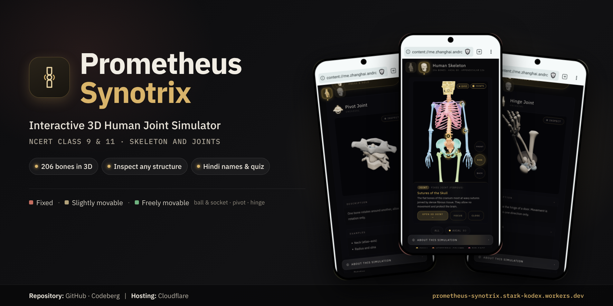
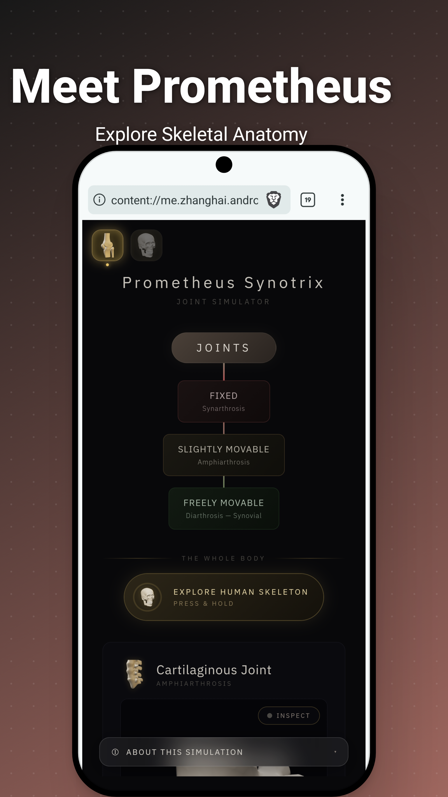
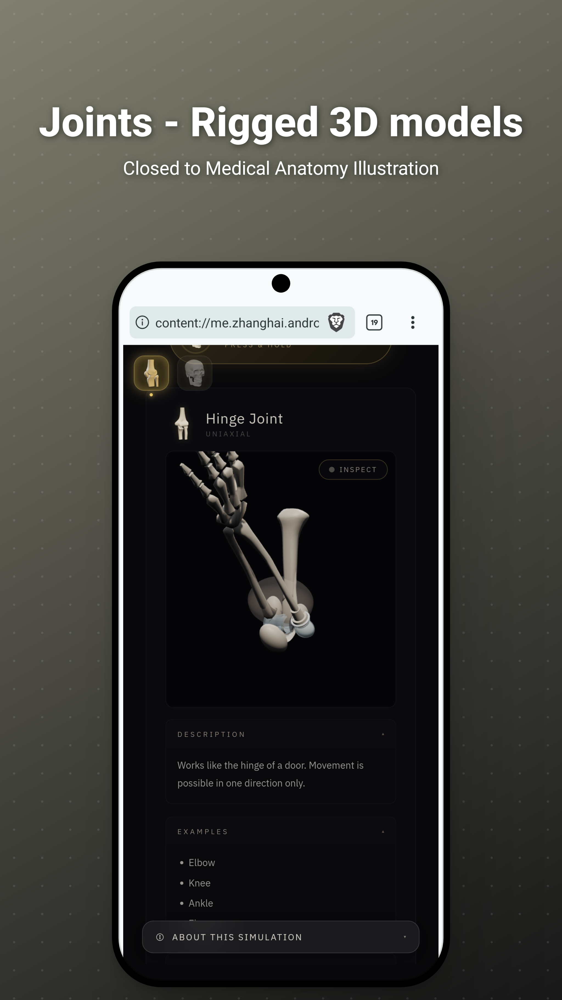
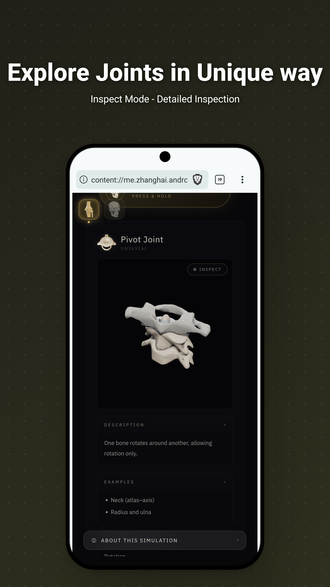
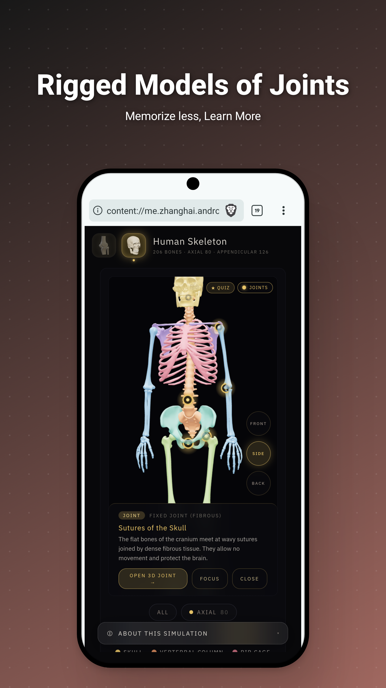
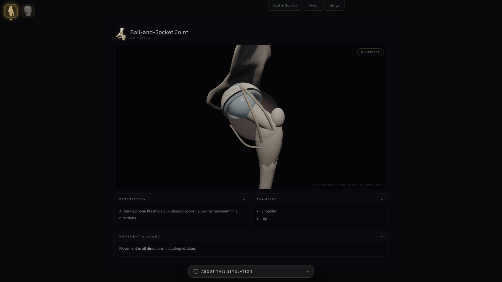
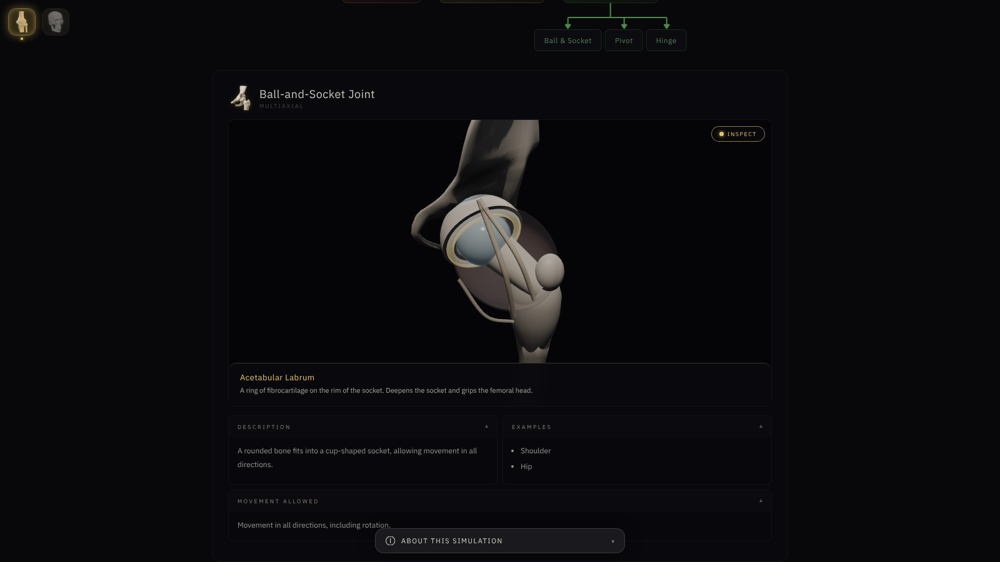
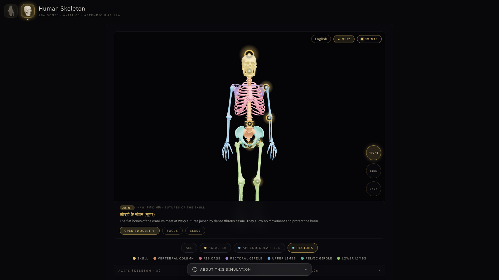
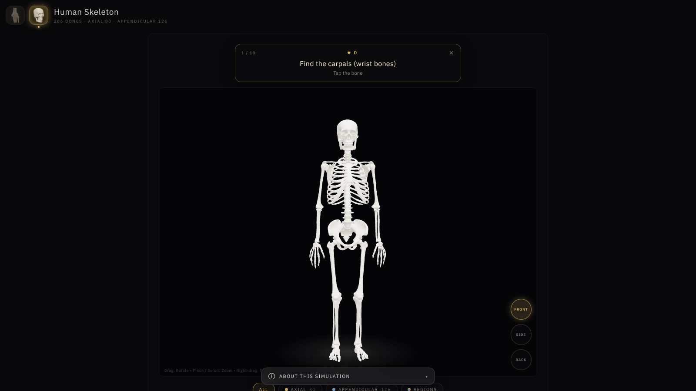

  

<h1 align="center">Prometheus Synotrix</h1>

<em>Interactive 3D Human Joint Simulator</em>

<a href="https://prometheus-synotrix.stark-kodex.workers.dev"><strong>Launch the Simulator</strong></a>

  <a href="#about">About</a> ·
  <a href="#screenshots">Screenshots</a> ·
  <a href="#explore">Explore</a> ·
  <a href="#science">Science</a> ·
  <a href="#controls">Controls</a> ·
  <a href="#technology">Technology</a> ·
  <a href="#credits">Credits</a> ·
  <a href="#releases">Releases</a> ·
  <a href="#license">License</a>

<em>Project dedicated to Lord Vishnu</em>

<table width="100%">
  <tr>
    <td width="20%" align="center"><b>206</b> bones in 3D</td>
    <td width="20%" align="center"><b>6</b> joint models</td>
    <td width="20%" align="center"><b>35+</b> named structures</td>
    <td width="20%" align="center"><b>10</b> question quiz</td>
    <td width="20%" align="center"><b>2</b> languages · English, Hindi</td>
  </tr>
</table>

---

## About

An interactive 3D simulator of the human skeleton and its joints. Real bone models show how joints are classified, what is inside a joint, and where each of the 206 bones sits. Aligned with NCERT Class IX and XI.

Built for classroom smart panels and phones.

---

## Screenshots

**On a phone**

<table width="100%">
  <tr>
    <td width="25%" align="center">
      
       <b>1 · Meet Prometheus</b>
    </td>
    <td width="25%" align="center">
      
       <b>2 · Rigged 3D Joints</b>
    </td>
    <td width="25%" align="center">
      
       <b>3 · Inspect Mode</b>
    </td>
    <td width="25%" align="center">
      
       <b>4 · Human Skeleton</b>
    </td>
  </tr>
</table>

**On a smart panel**

<table width="100%">
  <tr>
    <td width="50%" align="center">
      
       <b>5 · Ball-and-Socket Joint (Hip)</b>
    </td>
    <td width="50%" align="center">
      
       <b>6 · Name Any Structure</b>
    </td>
  </tr>
  <tr>
    <td width="50%" align="center">
      
       <b>7 · Regions and Hindi Names</b>
    </td>
    <td width="50%" align="center">
      
       <b>8 · Find-the-Bone Quiz</b>
    </td>
  </tr>
</table>

---

## Explore

| Section | What You See | Tap to Explore |
|:--|:--|:--|
| **Types of Joints** | Classification chart that opens a rigged 3D model of each joint, with description, examples and movement | Fixed · Slightly movable · Freely movable → Ball and socket · Pivot · Hinge · Inspect any structure |
| **Human Skeleton** | Full 3D skeleton: Axial 80 and Appendicular 126 bones | Any bone · Axial / Appendicular / Regions filters · Gold joint markers · Hindi names · 10-question quiz |

**Concepts:** joint classification · synarthrosis, amphiarthrosis, diarthrosis · synovial joint structure · axial and appendicular skeleton · body regions · bone identification · range of movement

---

## Science

| Joint | Also Called | Joined By | Movement | Examples | 3D Model |
|:--|:--|:--|:--|:--|:--|
| **Fixed** | Fibrous · Synarthrosis | Dense fibrous tissue | None | Skull sutures · tooth in socket (gomphosis) | Skull with sutures and a tooth socket |
| **Slightly movable** | Cartilaginous · Amphiarthrosis | Cartilage | Limited; absorbs shock | Between vertebrae · pubic symphysis · first rib–sternum | L3–L4 vertebrae and disc |
| **Freely movable** | Synovial · Diarthrosis | Fluid-filled cavity, cartilage, capsule | Free | Shoulder · hip · knee · elbow · wrist · ankle | Shoulder |
| ↳ Ball and socket | Multiaxial | Rounded head in a cup-shaped socket | All directions, including rotation | Shoulder · hip | Hip |
| ↳ Pivot | Uniaxial | One bone turning around another | Rotation | Atlas–axis (neck) · radius and ulna | Atlas–axis |
| ↳ Hinge | Uniaxial | Like a door hinge | Flexion and extension | Elbow · knee · ankle · fingers | Elbow |

<b>Structures you can inspect</b>

| Model | Named Structures |
|:--|:--|
| Cartilaginous (L3–L4) | Lumbar vertebrae L3 and L4 · Intervertebral disc · Nucleus pulposus |
| Synovial (shoulder) | Humerus · Scapula · Clavicle · Glenoid cavity · Glenoid labrum · Articular cartilage · Joint capsule · Synovial membrane · Synovial fluid · Coracohumeral and glenohumeral ligaments |
| Ball and socket (hip) | Femur · Hip bone · Acetabulum · Acetabular labrum · Articular cartilage · Joint capsule · Iliofemoral, pubofemoral and ischiofemoral ligaments |
| Hinge (elbow) | Humerus · Trochlea · Capitulum · Ulna · Trochlear notch · Olecranon process · Radius · Articular cartilage · Ligament |
| Pivot (atlas–axis) | Atlas (C1) · Axis (C2) · Third cervical vertebra (C3) · Transverse ligament · Articular cartilage |

<b>Skeleton divisions</b>

| Division | Bones |
|:--|:--|
| Axial · 80 | Skull 29 · Vertebral column 26 · Sternum 1 · Ribs 24 |
| Appendicular · 126 | Upper limbs 60 · Lower limbs 60 · Pectoral girdle 4 · Pelvic girdle 2 |

<b>Educational note</b>

Models are simplified for teaching and are not clinical references. Vertebrae are fused per region, each toe is one piece, the hyoid and ear ossicles are not shown, and teeth are shown but are not bones. Hindi names follow NCERT Hindi-medium terms.

---

## Controls

| Control | Function |
|:--|:--|
| Drag · Pinch or scroll · Right-drag | Rotate · Zoom · Pan |
| Inspect, then tap | Name a structure in a 3D joint |
| Tap a bone · Focus | Identify a bone · Zoom to it |
| Front · Side · Back | Skeleton views |
| Gold markers · Open 3D joint | Jump from the skeleton to the matching joint |
| Hindi · Quiz | Hindi bone names · Find-the-bone quiz |

---

## Technology

HTML · CSS · JavaScript · Three.js r160 · meshoptimizer · Cloudflare Pages

<b>Project files</b>

| File | Contents |
|:--|:--|
| `index.html` | Page structure |
| `style.css` | Styling |
| `script.js` | App logic (ES module), with the skeleton model embedded |
| `assets/Skeleton.obj` | Source model for the rigged bones |
| `assets/banner.png` | README banner |
| `assets/screenshots/` | README screenshots, numbered in display order |

---

## Credits

| Contributor | Role |
|:--|:--|
| **Aditya Sai Prasad**, M.Sc. Agri. Entomology, ASRB NET | Project Designer |
| Claude Opus 5.5 | Development |
| OpenAI Astra 6 | Image Generation |
| Perplexity Sonar 2 | Scientific Reasoning |

<b>3D models</b>

| Asset | Model | Creator | Licence |
|:--|:--|:--|:--|
| Bones and joints | [BodyParts3D](https://dbarchive.biosciencedbc.jp/en/bodyparts3d/) ([Fab model](https://fab.com/s/0ecc86fb0a8d)) | © The Database Center for Life Science | CC BY 4.0 |

Bone models were simplified and repositioned; additional bones are adapted from `Skeleton.obj`. Original creators retain ownership. [CC BY 4.0](https://creativecommons.org/licenses/by/4.0/)

<b>Libraries and fonts</b>

| Component | Licence |
|:--|:--|
| Three.js r160 | MIT |
| meshoptimizer | MIT |
| IBM Plex Sans | SIL Open Font License 1.1 |

---

## Releases

| Release | Title | Date |
|:--|:--|:--|
| RC VII | Final Touch-ups | 22 Oct 2026 |
| RC VI | Bug Fixes and UI Improvements | 22 Oct 2026 |
| RC V | Skeleton Learning Tool | 22 Oct 2026 |
| RC II | Rigged Skeleton and Regions | 17 Oct 2026 |
| RC I | Initial Release | 08 Aug 2026 |

Full history: [CHANGELOG.md](CHANGELOG.md)

---

## License

Source code: **GNU GPL-3.0** (see [LICENSE](LICENSE)). 3D models keep their own licences.

GitHub · Codeberg &nbsp;|&nbsp; Hosted on Cloudflare Pages

