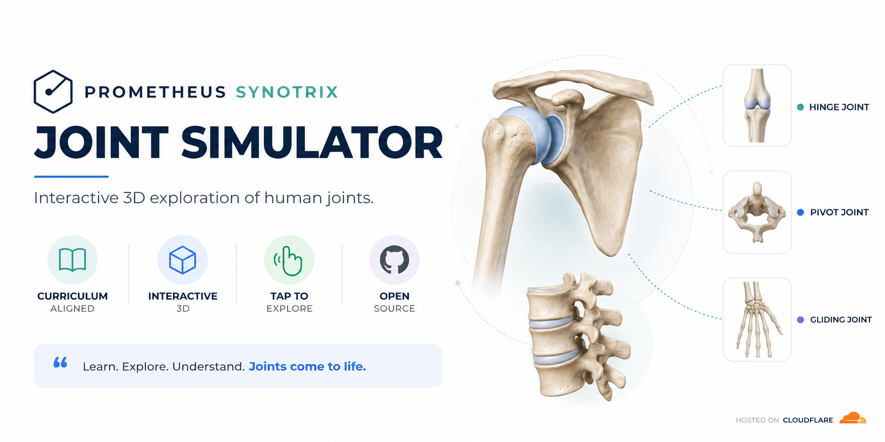
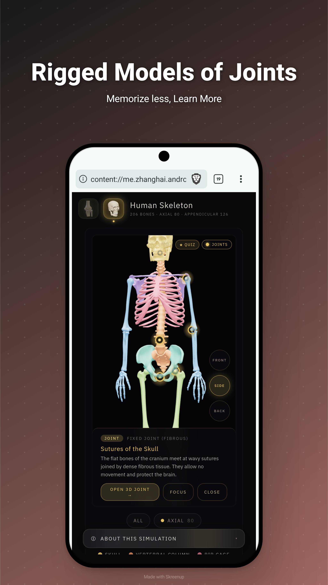

  

<h1 align="center">Prometheus Synotrix</h1>

<em>Interactive Human Joint Simulator</em>

<a href="https://prometheus-synotrix.stark-kodex.workers.dev"><strong>Launch the Simulator</strong></a>

  <a href="#about">About</a> ·
  <a href="#screenshots">Screenshots</a> ·
  <a href="#tabs">Tabs</a> ·
  <a href="#controls">Controls</a> ·
  <a href="#technology">Technology</a> ·
  <a href="#credits">Credits</a> ·
  <a href="#license">License</a>

<em>Project dedicated to Lord Vishnu</em>

---

## About

An interactive 3D simulator of the human skeleton and its joints. Real bone models show how joints are classified, what is inside a joint, and where each of the 206 bones sits. Aligned with NCERT Class IX and XI.

Built for classroom smart panels and phones.

---

## Screenshots

<table width="100%">
  <tr>
    <td width="50%" align="center">
      
       <b>1 · Introduction</b>
    </td>
    <td width="50%" align="center">
      
       <b>2 · Joint Anatomy</b>
    </td>
  </tr>
  <tr>
    <td width="50%" align="center">
      
       <b>3 · Joint Types</b>
    </td>
    <td width="50%" align="center">
      
       <b>4 · Human Skeleton</b>
    </td>
  </tr>
</table>

---

## Tabs

| Tab | What You See | Tap to Explore |
|:--|:--|:--|
| **Types of Joints** | Classification chart opening a 3D model of each joint, with description, examples and movement | Fixed (skull sutures, tooth in socket) · Slightly movable (vertebrae, pubic symphysis, first rib–sternum) · Ball and socket (shoulder, hip) · Pivot (atlas–axis) · Hinge (elbow, knee) · Inspect any structure |
| **Human Skeleton** | Full 3D skeleton: Axial 80 and Appendicular 126 bones | Any bone · Axial / Appendicular / Regions filters · Gold joint markers · हिंदी names · 10-question Quiz |

**Concepts:** joint classification · synarthrosis, amphiarthrosis, diarthrosis · synovial joint structure · axial and appendicular skeleton · body regions · bone identification · range of movement

<b>Skeleton divisions</b>

| Division | Bones |
|:--|:--|
| Axial · 80 | Skull 29 · Vertebral column 26 · Sternum 1 · Ribs 24 |
| Appendicular · 126 | Upper limbs 60 · Lower limbs 60 · Pectoral girdle 4 · Pelvic girdle 2 |

---

## Controls

| Control | Function |
|:--|:--|
| Drag · Pinch or scroll · Right-drag | Rotate · Zoom · Pan |
| Inspect, then tap | Name a structure in a 3D joint |
| Tap a bone · Focus | Identify a bone · Zoom to it |
| Front · Side · Back | Skeleton views |
| Gold markers · Open 3D joint | Jump from the skeleton to the matching joint |
| हिंदी · Quiz | Hindi bone names · Find-the-bone quiz |

<b>Educational note</b>

Models are simplified for teaching and are not clinical references. Vertebrae are fused per region, each toe is one piece, the hyoid and ear ossicles are not shown, and teeth are shown but are not bones. Hindi names follow NCERT Hindi-medium terms.

---

## Technology

HTML · CSS · JavaScript · Three.js r160 · meshoptimizer · Cloudflare Pages

<b>Project files</b>

| File | Contents |
|:--|:--|
| `index.html` | Page structure |
| `style.css` | Styling |
| `script.js` | App logic (ES module), with the skeleton model embedded |
| `assets/Skeleton.obj` | Source model for the rigged bones |
| `assets/` | Banner and screenshots for this README |

---

## Credits

| Contributor | Role |
|:--|:--|
| **Sai Prasad**, M.Sc. Agri. Entomology, ASRB NET | Project Designer |
| Claude Opus 5.5 | Development |
| OpenAI GPT Luna 5.7 | Image Generation |
| Perplexity Sonar 2 | Scientific Reasoning |

<b>3D models</b>

| Asset | Model | Creator | Licence |
|:--|:--|:--|:--|
| Bones and joints | [BodyParts3D](https://dbarchive.biosciencedbc.jp/en/bodyparts3d/) ([Fab model](https://fab.com/s/0ecc86fb0a8d)) | © The Database Center for Life Science | CC BY 4.0 |

Bone models were simplified and repositioned; additional bones are adapted from `Skeleton.obj`. Original creators retain ownership. [CC BY 4.0](https://creativecommons.org/licenses/by/4.0/)

<b>Libraries</b>

| Component | Licence |
|:--|:--|
| Three.js r160 | MIT |
| meshoptimizer | MIT |

---

## Releases

| Release | Title | Date |
|:--|:--|:--|
| RC VII | Final Touch-ups | 22 Oct 2026 |
| RC VI | Bug Fixes and UI Improvements | 22 Oct 2026 |
| RC V | Skeleton Learning Tool | 22 Oct 2026 |
| RC II | Rigged Skeleton and Regions | 17 Oct 2026 |
| RC I | Initial Release | 08 Aug 2026 |

Full history: [CHANGELOG.md](CHANGELOG.md)

---

## License

Source code: **GNU GPL-3.0** (see [LICENSE](LICENSE)). 3D models keep their own licences.

GitHub · Codeberg &nbsp;|&nbsp; Hosted on Cloudflare Pages

